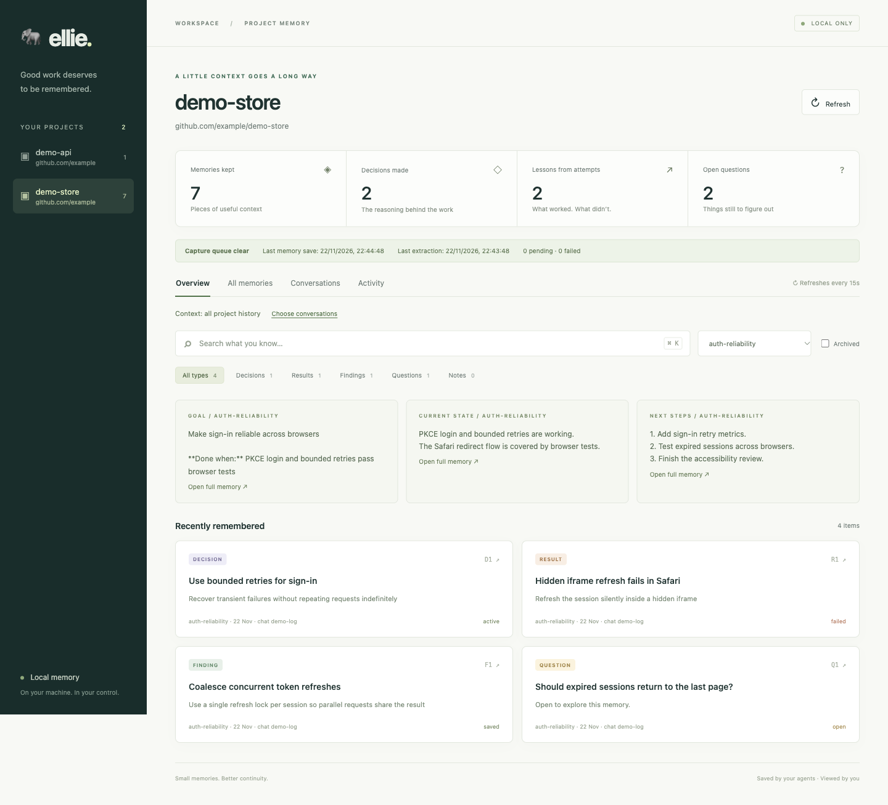
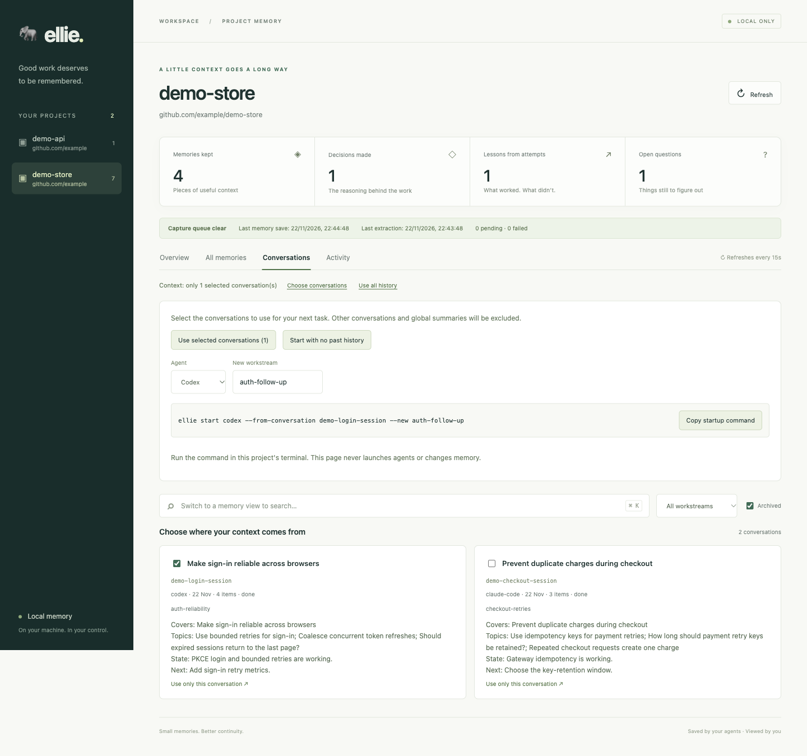
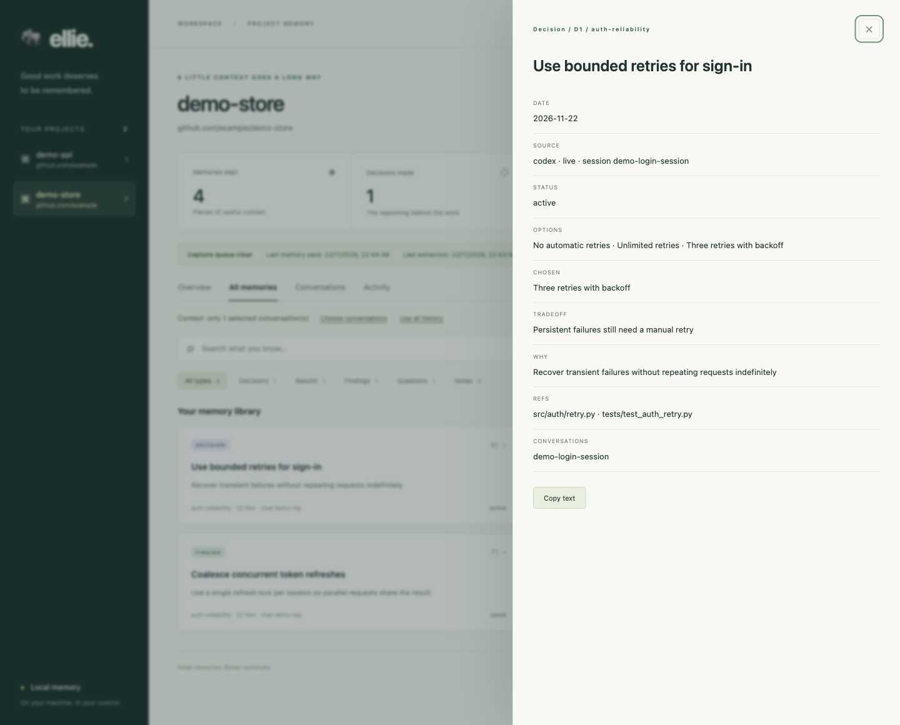

<div align="center">

# Ellie 🐘

**Pick up where your last coding session left off.**

Project memory for **Codex CLI** and **Claude Code**.

Keep the decisions, failed attempts, and next steps behind your code across chats and agents.

[Features](#features) · [Quickstart](#quickstart) · [Dashboard](#the-dashboard) · [User guide](docs/guide.md)

</div>

Bring your project's decisions and next steps into a new chat. Ellie saves
useful knowledge locally so you can continue a task, switch agents, or choose
exactly which past conversations to bring along.

**Local Markdown · Python 3.10+ · Zero runtime dependencies · Your existing CLI login**



*Your project's goals, current state, next steps, and saved knowledge in one place.*

All screenshots use fictional `demo-store` and `demo-api` projects with sample
memory. Names, timestamps, and capture statuses are illustrative.

## Features

| Feature | What you get |
| --- | --- |
| 🐘 **Memory across agents** | Save context with Codex and load it in Claude Code, or the other way around, for the same project. |
| 🔄 **Automatic capture** | With trusted hooks enabled, background checkpoints extract useful knowledge as you work. Ask for a handoff to save state and next steps immediately. |
| 🎯 **Choose your context** | Load one conversation, combine several, or start fresh. Conversation-only selection excludes other chats and unrelated shared summaries. |
| 🧵 **Parallel workstreams** | Keep separate goals, current state, and next steps for tasks running in different chats. |
| 💡 **Decisions with reasons** | Keep alternatives, the chosen approach, tradeoffs, and why. Record failed attempts, findings, and open questions too. |
| 🔎 **Search and task briefings** | Find saved decisions, results, findings, and questions, or assemble relevant context for your next task. |
| 🖥️ **A local dashboard** | Browse projects, search memory, inspect source conversations, and see pending or failed captures in your browser. |
| 📝 **Readable, editable storage** | Markdown is the source of truth. The search index is rebuildable, and memory lives outside your repository. |
| 🔒 **Saving controls** | Pause saving, exclude a conversation, mark private text, or disable future transcript archives. |

Memory storage and search run locally. Extraction uses your installed
`codex exec` or `claude -p`, its existing login, and its configured model provider.
No separate API key or hosted memory service is needed. Extraction consumes your
CLI plan's normal usage.

## Quickstart

You need Git, [uv](https://docs.astral.sh/uv/getting-started/installation/), and
Codex CLI or Claude Code installed and signed in. Ellie requires Python 3.10+;
uv can download it during installation.

### 1. Install and connect your agents

```sh
git clone https://github.com/prakx1/ellie.git
cd ellie
uv tool install --python 3.10 .
ellie install
ellie doctor
```

`uv tool install` installs the executable. `ellie install` registers the MCP
tools and automatic capture hooks for Codex, plus Claude Code when detected.
Use `ellie install --codex` or `ellie install --claude` to choose one explicitly.

**Restart your agent after setup.** In Codex, open `/hooks` and review and trust
Ellie's commands. Automatic capture needs enabled, trusted hooks. Keep the
installation running until it finishes; Ctrl-Z suspends it.

### 2. Work in your project as usual

```sh
cd /path/to/your-project
codex
# Or: claude
```

Send your normal first message. When saved context exists, Ellie's instructions
ask the agent to offer a memory picker in its first reply:

```text
Ellie 🐘 — Which memory should I use?
0) Start fresh — no past memory
1) Conversation: Make sign-in reliable across browsers · Codex · 4 items
   State: PKCE login and bounded retries are working
   Next: Add sign-in retry metrics
2) Workstream: checkout-retries · Prevent duplicate charges
m) More choices
```

Choose the context you need and continue your task. The picker is rendered by
the agent after your first message; its appearance can vary. A new project with
no saved context skips the picker. For a terminal picker before launch, run
`ellie start codex` or `ellie start claude` instead.

You can also ask directly:

> Use Ellie for this project. Create a workstream called `auth-refactor`, bind
> this conversation to it, and save important decisions and findings as we work.

### 3. Leave a useful handoff

With capture set to `auto` (the default), trusted hooks queue background review
as you work. For an immediate save through the agent's memory tools, say:

> Save an Ellie handoff with the current state, what we learned, and next steps.

Use separate workstreams for parallel tasks. In a later session, select the
relevant conversation or workstream to continue, including when switching agents.

### 4. See what Ellie remembers

In another terminal:

```sh
ellie ui
```

Open [127.0.0.1:8767](http://127.0.0.1:8767/) if your browser does not open
automatically. **Keep that terminal running.** The dashboard runs separately
from capture; saving does not require an open browser.

Need another install method or an existing-install upgrade?
See the [installation guide](docs/guide.md#install).

## Choose the context for your next task

A **workstream** groups the goal, state, and next steps for a task. A
**conversation** identifies the chat that produced a piece of memory. You can
use selected past conversations as context while writing new memory to a new
workstream.

```sh
ellie conversations
ellie start codex --from-conversation CONVERSATION_ID --new follow-up
ellie start claude --pick-conversations
ellie start codex --no-history --new fresh-task
```

Repeat `--from-conversation` to combine sources. Selected conversations stay
selected when you search or load memory; unrelated chats remain excluded.
In chat, say “Use only conversation ID for context, and create a new workstream
called NAME.”

To search before starting:

```sh
ellie recall 'token refresh'
ellie brief 'add retry metrics' --conversation CONVERSATION_ID
ellie start --about 'token refresh'
```

See [all context-selection options](docs/guide.md#selecting-context), including
mixing workstreams, loading individual items, and previewing a startup prompt.

## The dashboard

See what a conversation is about, choose what to reuse, and inspect the
reasoning behind each saved item. Click either screenshot to view it at full size.

| Choose your context | Keep the reasoning |
| :---: | :---: |
| [](docs/images/conversation-selection.png) | [](docs/images/decision-detail.png) |
| Select specific chats and copy a startup command for a new task. | Open a decision to see what was chosen, why, and where it came from. |

The dashboard includes project switching, goals/state/next steps, ranked search,
type and workstream filters, archived items, conversation history, and activity.
It refreshes every 15 seconds while visible and shows the last memory save
separately from the last extraction.

The viewer does not edit memory or launch agents. Its startup command is copied
for you to run in your project's terminal. The server binds only to this machine.
Use `ellie ui --port 0` if the default port is busy.

[Dashboard usage and troubleshooting →](docs/guide.md#browse-your-memory)

## How memory gets saved

1. **Work normally.** Installed, trusted hooks track the current conversation
   and queue checkpoints while you work and at turn/session boundaries.
2. **Extract useful context.** A background worker reviews new transcript
   content through your CLI using isolated, read-only extraction settings.
3. **Keep structured memory.** Ellie validates the output, deduplicates items,
   links them to their source, and preserves decisions, results, findings,
   questions, and handoff state in Markdown outside the repo.
4. **Bring it into the next session.** Choose a workstream or specific source
   conversations through chat, the launcher, or a command copied from the UI.

Agents can also save directly through MCP tools during a session. Background
capture is asynchronous: `ellie status` shows saved times, pending work, and
failures. Failed jobs remain available for an explicit retry with
`ellie capture --wait`.

To bring older sessions into memory, preview them with `ellie backfill`; Ellie
asks for confirmation before extraction uses your CLI plan.

[Capture details, retries, and limitations →](docs/guide.md#how-capture-works)

## Your files, your controls

Memory is stored under `~/.ellie` by default; set `ELLIE_HOME` to choose another
location. Ellie does not modify your project repository. You can inspect or
edit the Markdown and rebuild search with `ellie reindex`.

```sh
ellie privacy pause
ellie privacy resume
ellie privacy exclude CONVERSATION_ID
ellie privacy --archives off
```

Wrap sensitive text in `<private>...</private>` to filter it from future
Ellie-owned memory and extraction input. Privacy controls apply to future
saving; they do not erase existing data or change your agent's own transcript.
Extraction still sends context through your configured CLI/model provider.

[Privacy and archive controls →](docs/guide.md#privacy-and-save-status)

## Everyday commands

Run project commands from the project you are working on.

| Command | Use it to… |
| --- | --- |
| `ellie status` | Check saved memory and capture health. |
| `ellie start codex` / `ellie start claude` | Choose memory before launching an agent. |
| `ellie new NAME --goal '…' --done-when '…'` | Create a workstream with a clear goal. |
| `ellie conversations` | Find the conversations behind a project's memory. |
| `ellie recall 'QUERY'` | Search saved knowledge. |
| `ellie brief 'TASK'` | Assemble relevant context for a task. |
| `ellie ui` | Open the local dashboard. |
| `ellie capture --wait` | Capture uncaptured sessions and explicitly retry pending jobs. |
| `ellie backfill` | Preview and capture older sessions after confirmation. |
| `ellie doctor` | Diagnose setup, session formats, and store health. |

The [full command reference](docs/guide.md#commands) also covers editing,
archiving, imports, timelines, project linking, configuration, and uninstalling.

## Upgrade

From your Ellie checkout:

```sh
git pull --ff-only
uv tool install --force --reinstall --python 3.10 .
ellie install
ellie doctor
```

Run both the package update and `ellie install`, then restart your agents and
review any changed Codex hooks. Updating the executable alone does not refresh
agent integration. Existing memories and unrelated settings are preserved.

## Documentation and verification

- [User guide](docs/guide.md) — detailed setup, workflows, commands, configuration, and troubleshooting.
- [Verification report](QA_REPORT.md) — 141 tests passed in each of four recorded runs for v0.3.5, browser checks, and the remaining live-provider checks.
- [v1 specification](spec.md) and [acceptance review](ACCEPTANCE.md) — the design and original acceptance results.
- [Report an issue](https://github.com/prakx1/ellie/issues) — include `ellie --version`, the agent version, and relevant diagnostics with private data removed.

Recorded verification was performed on macOS. Authenticated provider extraction
and public PyPI publishing remain separate checks; install from this repository
using the commands above. Development uses temporary agent profiles and memory
stores; see the [development guide](docs/guide.md#troubleshooting-and-development).
